<picture><source media="(prefers-color-scheme: dark)" srcset="assets/hero-dark.svg"></picture>

<picture><source media="(prefers-color-scheme: dark)" srcset="assets/social-l-dark.svg"></picture><a href="https://discord.com/"><picture><source media="(prefers-color-scheme: dark)" srcset="assets/social-1-dark.svg"></picture></a><a href="me@radioactiverm.net"><picture><source media="(prefers-color-scheme: dark)" srcset="assets/social-2-dark.svg"></picture></a><picture><source media="(prefers-color-scheme: dark)" srcset="assets/social-r-dark.svg"></picture>

<picture><source media="(prefers-color-scheme: dark)" srcset="assets/about-dark.svg"></picture>

<picture><source media="(prefers-color-scheme: dark)" srcset="assets/stack-dark.svg"></picture>

<a href="https://github.com/Radioactiverm/dpmj-api"><picture><source media="(prefers-color-scheme: dark)" srcset="assets/project-dpmj-api-dark.svg"></picture></a>&nbsp;<a href="https://github.com/Radioactiverm/Radioactiverm"><picture><source media="(prefers-color-scheme: dark)" srcset="assets/project-radioactiverm-dark.svg"></picture></a>

<a href="https://github.com/Radioactiverm/flipper-fsociety-asset-pack"><picture><source media="(prefers-color-scheme: dark)" srcset="assets/project-flipper-fsociety-asset-pack-dark.svg"></picture></a>

<picture><source media="(prefers-color-scheme: dark)" srcset="assets/streak-dark.svg"></picture>

<picture><source media="(prefers-color-scheme: dark)" srcset="assets/stats-dark.svg"></picture>

<picture><source media="(prefers-color-scheme: dark)" srcset="assets/wave-dark.svg"></picture>

<a href="https://radioactiverm.net"><picture><source media="(prefers-color-scheme: dark)" srcset="assets/button-1-dark.svg"></picture></a>&nbsp;&nbsp;<a href="https://kdejebus.cz"><picture><source media="(prefers-color-scheme: dark)" srcset="assets/button-2-dark.svg"></picture></a>&nbsp;&nbsp;<a href="https://github.com/radioactiverm?tab=repositories"><picture><source media="(prefers-color-scheme: dark)" srcset="assets/button-3-dark.svg"></picture></a>

